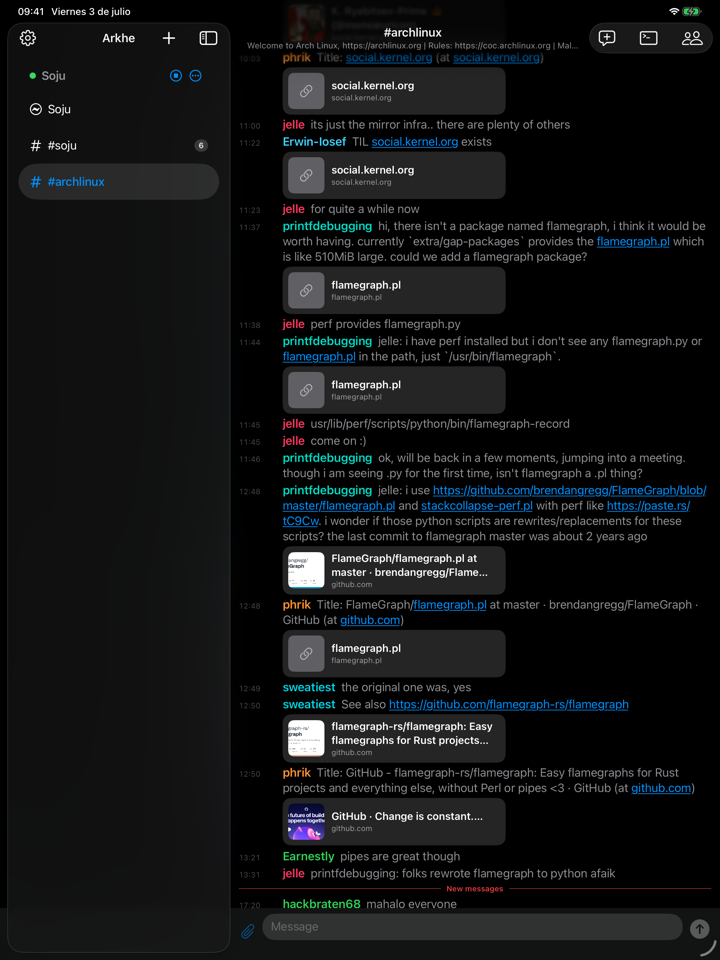
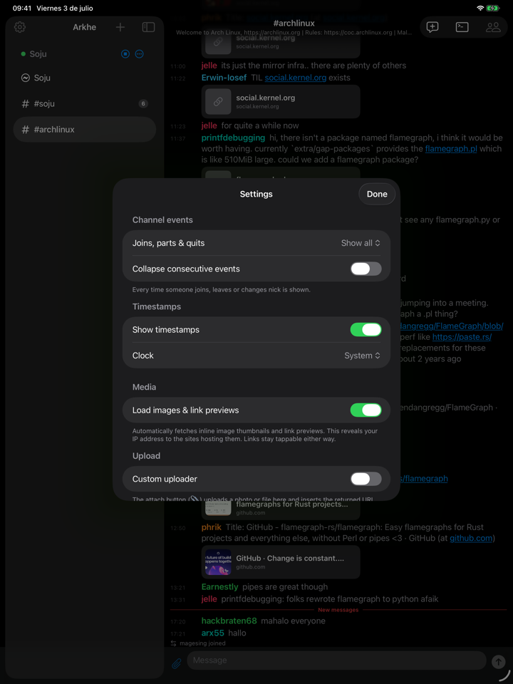
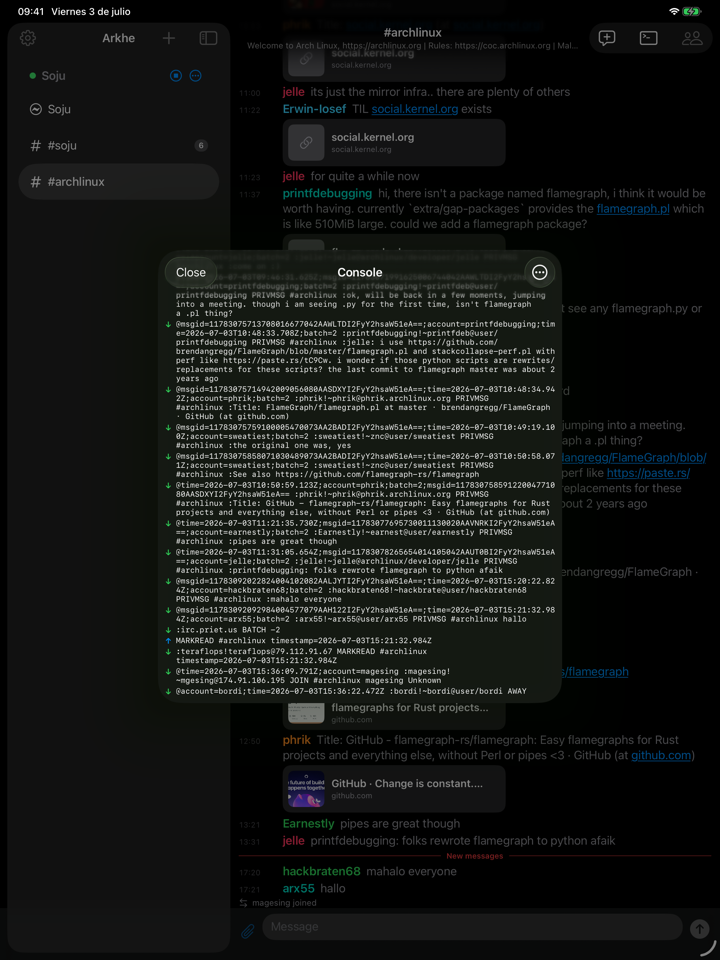

# Arkhe

An IRC client for iPhone/iPad focused on **IRCv3**, with **SASL** (PLAIN and
EXTERNAL/**CertFP**) and compatible with soju-style bouncers/relays.

Written in Swift 6 + SwiftUI, with a pure, tested protocol core.

## Screenshots

<p align="center">
  
  &nbsp;
  
  &nbsp;
  
</p>

## Architecture

```
IRCCore/                  Pure SPM package (Foundation). No platform dependencies.
  IRCMessage*             IRCv3 message model + parser + encoder (tags, source, trailing)
  IRCTags                 message-tags escaping (\s \: \\ \r \n)
  SASL                    PLAIN and EXTERNAL: responses and chunking into 400-byte pieces
  Capability*             CAP LS/REQ/ACK/END + SASL flow as a pure state machine
  ISupport / CaseMapping  Parsing of 005 and case folding (ascii/rfc1459)
  → 30 tests via `swift test`

App/                      iOS target (Arkhe)
  Transport/
    IRCConnection         Actor over NWConnection: TLS, CRLF framing, AsyncStream of events
    TLSIdentity           PKCS#12 client identity for CertFP + SHA-256 fingerprint
  Session/
    IRCSession            @Observable @MainActor: orchestrates registration, dispatch, buffers, soju
    RuntimeModels         Buffer, ChatLine, Member, BouncerNetwork
    SessionConfig         Sendable snapshot of the config
  Model/
    ServerConfig          @Model SwiftData (secrets in Keychain, not in the store)
    Keychain              Keychain wrapper for passwords and certificate passphrases
  Store/ClientStore       Runtime state: live sessions + selection
  Views/                  Adaptive iPhone/iPad NavigationSplitView
```

## IRCv3 features

- `message-tags`, `server-time` (real timestamps in history), `batch`
- `sasl` with **PLAIN** and **EXTERNAL** (CertFP via TLS client certificate)
- `cap-notify` (CAP NEW/DEL), `echo-message` (local echo only when it isn't active)
- `account-notify`, `away-notify`, `chghost`, `extended-join`, `multi-prefix`,
  `userhost-in-names`, `setname`, `invite-notify`
- `draft/chathistory` — automatic scrollback when joining a channel
- **soju**: `soju.im/bouncer-networks` (+notify) — discovers and lists the bouncer's networks

## Requirements

- Xcode 26+, iOS 17+ (SwiftData + Observation)
- `xcodegen` (`brew install xcodegen`)

## Build and run

```sh
# Protocol core (tests)
cd IRCCore && swift test

# Generate the project and build the app
xcodegen generate
xcodebuild -project Arkhe.xcodeproj -scheme Arkhe \
  -destination 'platform=iOS Simulator,name=iPhone 16' build
```

Open `Arkhe.xcodeproj` in Xcode to run on a simulator or device.

> **If you build it yourself to install on your own iPhone:** the project ships
> with my `DEVELOPMENT_TEAM` and `PRODUCT_BUNDLE_IDENTIFIER` (`im.arkhe.client`)
> in `project.yml`. Change them to your own (your Apple Team ID and your own
> bundle id, e.g. `com.yourname.arkhe`) and run `xcodegen generate` again. The
> `.xcodeproj` is not versioned: it is generated from `project.yml`.

## CertFP with soju

1. Generate a client certificate and package it as a `.p12`.
2. In the app: new server → SASL = **EXTERNAL** → import the `.p12`.
3. Copy the **SHA-256 fingerprint** the app shows and register it on the network
   (`/msg NickServ CERT ADD`) or in your soju config.

## Roadmap (next iteration)

- Local/push notifications for mentions and private messages
- Message history persistence (only the config is persisted today)
- Full per-network bouncer multiplexing (bind / live network switching in the UI)
- SCRAM-SHA-256, additional slash commands, theming/settings, search

## App Store

Arkhe is available on the App Store (€0.99) as a convenient way to install it
and to support development. The code is open: if you'd rather build it yourself,
follow the instructions above.

## License

[Apache 2.0](LICENSE) © 2026 Carlos Prieto

The code is open source under Apache 2.0. The **name "Arkhe" and the icon** are
trademarks of the author and are not licensed with the code (Apache 2.0, §6):
a fork must use its own name and icon.
