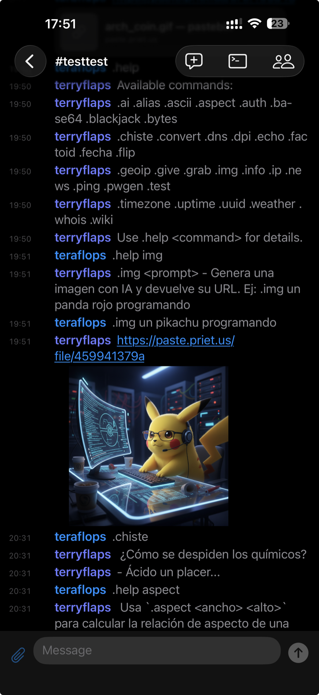
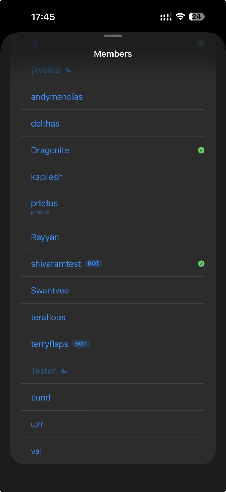
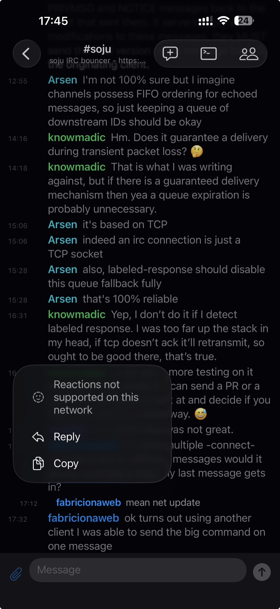
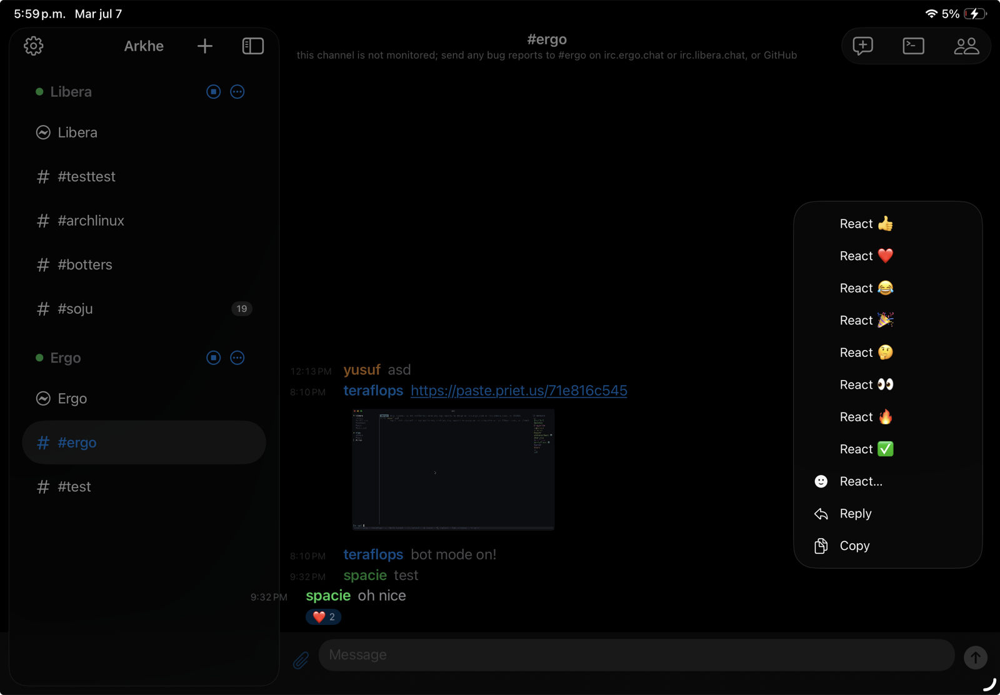
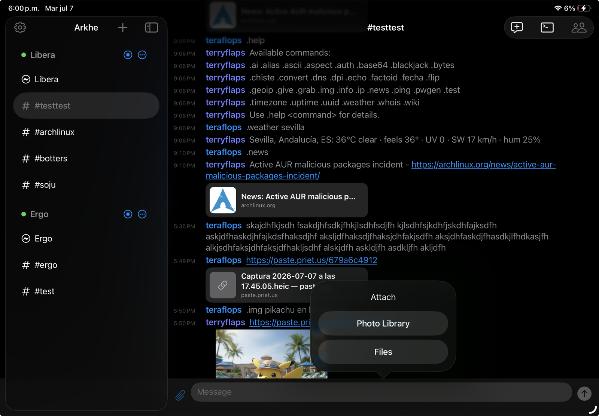
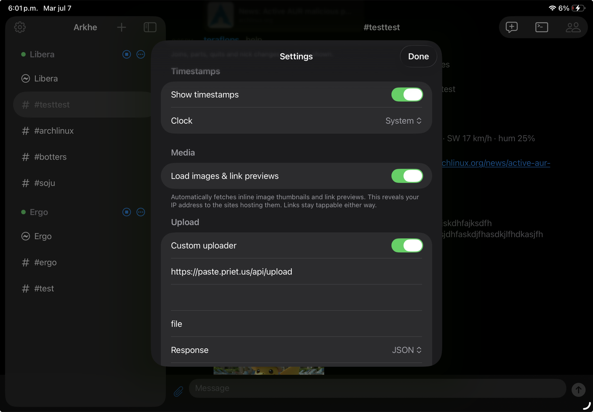

# Arkhe

<p>
  <a href="https://apps.apple.com/app/arkhe-irc/id6781800095"></a>
  <a href="https://apps.apple.com/app/arkhe-irc/id6781800095"></a>
  <a href="LICENSE"></a>
  
</p>

An IRC client for iPhone/iPad focused on **IRCv3**, with **SASL** (PLAIN,
SCRAM-SHA-256 and EXTERNAL/**CertFP**) and compatible with soju-style bouncers/relays.

Written in Swift 6 + SwiftUI, with a pure, tested protocol core.

## Screenshots

<p align="center">
  
  &nbsp;
  
  &nbsp;
  
</p>
<p align="center">
  
  &nbsp;
  
</p>
<p align="center">
  
</p>

## Architecture

```
IRCCore/                  Pure SPM package (Foundation). No platform dependencies.
  IRCMessage*             IRCv3 message model + parser + encoder (tags, source, trailing)
  IRCTags                 message-tags escaping (\s \: \\ \r \n)
  SASL                    PLAIN and EXTERNAL: responses and chunking into 400-byte pieces
  Capability*             CAP LS/REQ/ACK/END + SASL flow as a pure state machine
  ISupport / CaseMapping  Parsing of 005 and case folding (ascii/rfc1459)
  SCRAM / STSPolicy       SCRAM-SHA-256 client and STS policy parsing
  IgnoreMask              /ignore rules: hostmask globs and $a:account
  → tests via `swift test`

App/                      iOS target (Arkhe)
  Transport/
    IRCConnection         Actor over NWConnection: TLS, CRLF framing, AsyncStream of events
    TLSIdentity           PKCS#12 client identity for CertFP + SHA-256 fingerprint
  Session/
    IRCSession            @Observable @MainActor: orchestrates registration, dispatch, buffers, soju
    RuntimeModels         Buffer, ChatLine, Member, BouncerNetwork
    SessionConfig         Sendable snapshot of the config
  Model/
    ServerConfig          @Model SwiftData (secrets in Keychain, not in the store)
    Keychain              Keychain wrapper for passwords and certificate passphrases
  Store/ClientStore       Runtime state: live sessions + selection
  Notifications/          Local alerts, badge, tap→buffer + APNs/Web Push registration
  Views/                  Adaptive iPhone/iPad NavigationSplitView

Shared/WebPush/           Shared by the app and the Notification Service Extension
  WebPushKeys             P-256 keypair + auth secret in a shared-App-Group Keychain
  WebPushCrypto           RFC 8291 (aes128gcm) decryption — verified vs the RFC test vector
NotificationService/      Notification Service Extension: decrypts Web Push, formats the alert
push-relay/               Go: content-blind Web Push → APNs relay (stdlib only; self-hostable)
```

## IRCv3 features

- **Core**: `message-tags`, `server-time` (real timestamps in history), `batch`,
  `labeled-response`, `cap-notify` (CAP NEW/DEL), `standard-replies` (FAIL/WARN/NOTE)
- **Security**: `sts` — upgrades to TLS and remembers the policy per host;
  `sasl` with **PLAIN**, **SCRAM-SHA-256** (used automatically when offered)
  and **EXTERNAL** (CertFP via TLS client certificate)
- **Presence & identity**: `account-notify`, `account-tag`, `away-notify`,
  `chghost`, `extended-join`, `multi-prefix`, `userhost-in-names`, `setname`,
  `invite-notify`, `echo-message` (local echo only when it isn't active),
  `monitor` + `extended-monitor` (online/away dots on private conversations),
  WHOX for away state and bot badges on join
- **Profiles**: `draft/metadata-2` — shows avatars, display names and pronouns
  in the member list, and lets you publish your own profile per server
- **History**: `draft/chathistory` — automatic scrollback, catch-up after a
  reconnect, and jump to the original of a reply (`AROUND`);
  `draft/event-playback`; `draft/chathistory-end`; history also kept on device
- **Rich messaging**:
  - `draft/read-marker` (`MARKREAD`) — read position syncs across every client on
    the bouncer, so unread counts and the "new messages" divider follow you device
    to device
  - `draft/multiline` — sends and renders multi-line messages as a single message
  - `draft/message-redaction` (`REDACT`) — delete your own messages (or moderate)
  - `+reply`/`+draft/reply` threaded replies, `+draft/react`/`+draft/unreact`
    emoji reactions, and `+typing` typing indicators
- **Files**: `draft/FILEHOST` uploads, or any custom HTTP uploader/pastebin;
  inline images (small, medium or large) and link previews
- **Push**: `draft/webpush` and `soju.im/webpush` — notifications while the app
  is closed
- **soju**: `soju.im/search` — server-side message search (falls back to
  searching on the device); `soju.im/bouncer-networks` (+notify);
  `no-implicit-names` — member rosters fetched lazily, per channel viewed;
  blocks, mutes and pins synced with the bouncer (`soju.im/blocked`,
  `soju.im/muted`, `soju.im/pinned`)

## Client features

- `/ignore` by nick, hostmask or account — hidden in chat and notifications
- Pin and mute conversations, per server
- Search messages in a conversation or across all of them
- Answers CTCP `VERSION`, `PING`, `TIME` and `CLIENTINFO`; `/ctcp` to send them
- Slash commands: `/join`, `/part`, `/msg`, `/query`, `/me`, `/nick`, `/topic`,
  `/whois`, `/invite`, `/setname`, `/ignore`, `/ctcp`, `/raw` and more
- Smart join/part filtering, collapsed events, 12/24h timestamps
- Raw protocol log (passwords redacted) for debugging
- Liquid Glass message field on iOS 26

## Requirements

- Xcode 26+, iOS 17+ (SwiftData + Observation)
- `xcodegen` (`brew install xcodegen`)

## Build and run

```sh
# Protocol core (tests)
cd IRCCore && swift test

# Generate the project and build the app
xcodegen generate
xcodebuild -project Arkhe.xcodeproj -scheme Arkhe \
  -destination 'platform=iOS Simulator,name=iPhone 17' build
```

Open `Arkhe.xcodeproj` in Xcode to run on a simulator or device.

> **If you build it yourself to install on your own iPhone:** the project ships
> with my `DEVELOPMENT_TEAM` and `PRODUCT_BUNDLE_IDENTIFIER` (`im.arkhe.client`)
> in `project.yml`. Change them to your own (your Apple Team ID and your own
> bundle id, e.g. `com.yourname.arkhe`) and run `xcodegen generate` again. The
> `.xcodeproj` is not versioned: it is generated from `project.yml`.
>
> Remote push additionally needs the **Push Notifications** and **App Groups**
> capabilities on your App IDs (the app and its `…NotificationService`) plus a
> relay — or remove the `CODE_SIGN_ENTITLEMENTS` lines from `project.yml` to build
> without push (local notifications still work). See
> [`docs/push-notifications.md`](docs/push-notifications.md).

## CertFP with soju

1. Generate a client certificate and package it as a `.p12`.
2. In the app: new server → SASL = **EXTERNAL** → import the `.p12`.
3. Copy the **SHA-256 fingerprint** the app shows and register it on the network
   (`/msg NickServ CERT ADD`) or in your soju config.

## Notifications

**Local** notifications for **mentions** (your nick — or any custom **highlight
keyword** — in a channel) and **direct messages**, with per-type toggles,
previews and sound in Settings. **Reply inline** from the notification without
opening the app; **mute** a noisy conversation's alerts (long-press it in the
sidebar); alerts are suppressed for the conversation you're already viewing. On
backgrounding the connection is held briefly to catch a last message; on return
it reconnects and pulls missed scrollback via chathistory.

**Remote push** for when the app is fully closed uses the bouncer's own Web Push
(`soju.im/webpush`) — no per-user infrastructure. soju detects the highlight/DM
and sends it **end-to-end encrypted** (RFC 8291) to a small **content-blind**
relay ([`push-relay/`](push-relay/), Go), which forwards it to APNs; a
Notification Service Extension decrypts it on-device. The relay never sees
message content or credentials. Self-hosters can point the app at their own
relay. See [`docs/push-notifications.md`](docs/push-notifications.md).

## Roadmap

- `/` command suggestions, day separators, forwarding messages
- Themes

## App Store

Arkhe is [available on the App Store](https://apps.apple.com/app/arkhe-irc/id6781800095) (€0.99) as a convenient way to install it
and to support development. The code is open: if you'd rather build it yourself,
follow the instructions above.

## License

[Apache 2.0](LICENSE) © 2026 Carlos Prieto

The code is open source under Apache 2.0. The **name "Arkhe" and the icon** are
trademarks of the author and are not licensed with the code (Apache 2.0, §6):
a fork must use its own name and icon.
